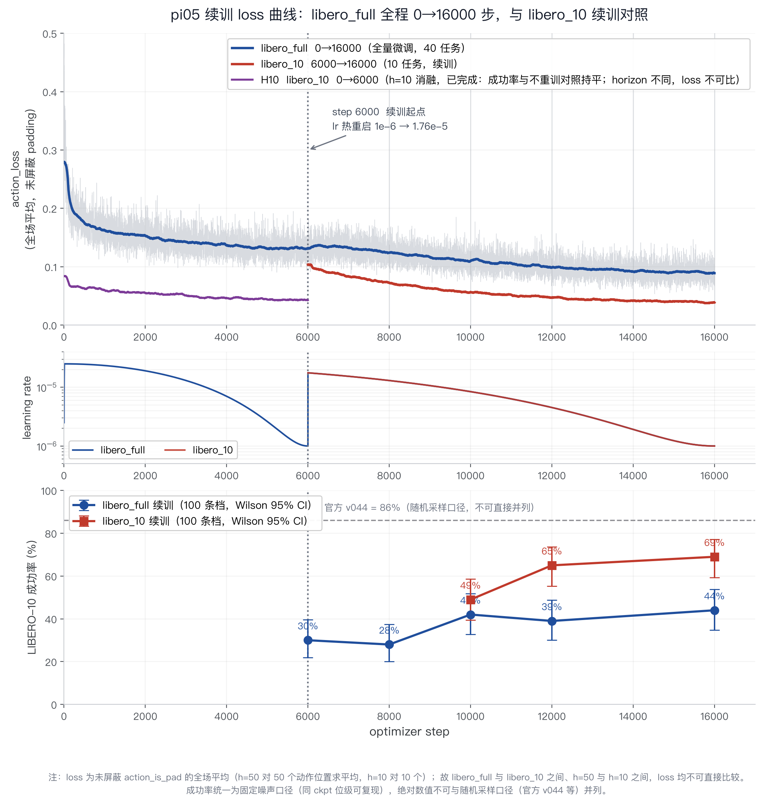
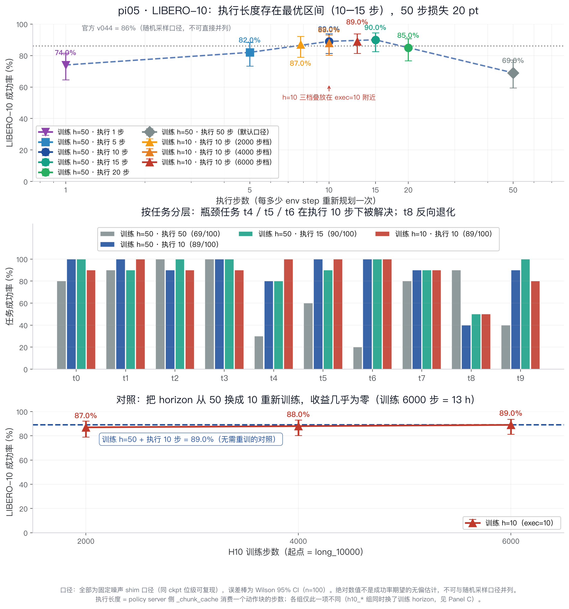

# 周会报告 I：π0.5 全量微调达 90% 成功率的完整分析

> 日期：2026-10-09 ｜ 任务：LIBERO-10（10 任务 × 10 episode）｜ 机器人：Franka（LIBERO 仿真）

## 一、一句话结论

通过 **libero_10 专攻续训 10000 步（bs32）+ 推理期执行长度调优（50→15 步）**，在 LIBERO-10 上把成功率从 **30% 提升到 90%**，并定位出**执行长度（re-planning 频率）是比训练本身更大的杠杆**（单变量 +21 pt，p=0.0003）。

## 二、权重链（如何走到 90%）

$\text{pi05\_base} \xrightarrow[\text{libero\_full}]{\text{bs32},\ 0\to6000\ \text{步}} 30\% \xrightarrow[\text{libero\_10}]{\text{续训}\ 10000\ \text{步}} 69\% \xrightarrow[\text{仅改推理}]{\text{执行步数}\ 50\to15} \boxed{90\%}$

| 阶段          | 数据                         |                   训练量 |  成功率（同口径） |
| ----------- | -------------------------- | --------------------: | --------: |
| 阶段 1：混合预微调  | libero_full（40 任务，273k 帧）  |    6000 步 ≈ 0.9 epoch |     30.0% |
| 阶段 2：专攻续训   | libero_10（379 ep / 101k 帧） | +10000 步 ≈ +3.1 epoch |     69.0% |
| 阶段 3：执行长度调优 | —（**不训练，纯推理超参**）           |                     0 | **90.0%** |

## 三、阶段 2：专攻续训的学习曲线

各 checkpoint 以 100 条档评测（exec=50 口径）：

| step |  6000 |  8000 | 10000 | 12000 |     16000 |
| ---- | ----: | ----: | ----: | ----: | --------: |
| 成功率  | 30.0% | 47.0% | 49.0% | 65.0% | **69.0%** |

端点配对（McNemar 精确）：10000→16000 = **+20.0 pt，p=0.0008**。对照组（继续用 libero_full 混训）同预算只到 44%，**专攻显著优于混训（+25 pt，p=0.0001）**。

### loss 与成功率的脱钩（重要教训）



- libero_full 线 loss **严格单调下降**（0.17→0.09）但成功率非单调（30→28→42→39→44），$r=-0.64$
- **<1.2 epoch 时 loss 不能用来挑 checkpoint**——下降主要来自易拟合任务，与整体成功率的边际贡献被任务间方差淹没

## 四、阶段 3：执行长度是首要瓶颈（消融）

同一 checkpoint（`long/ckpt_16000`）**只改推理期执行步数**，训练完全不动：



| 执行步数 |     1 |     5 | **10** |    **15** |    20 | 50（默认） |
| ---- | ----: | ----: | -----: | --------: | ----: | -----: |
| 成功率  | 74.0% | 82.0% |  89.0% | **90.0%** | 85.0% |  69.0% |

- **单峰曲线，最优区间 10–15 步**：50→15 = **+21.0 pt，p=0.0003**
- 两端对称变差：exec=1（74%）≈ exec=50（69%），配对 p=0.50 无差异——过短切碎动作块一致性，过长闭环不足误差累积
- 机制：pi05 一次前向生成 50 步动作块，server 的 `_chunk_cache` 逐消费；执行长度=重规划频率，**是推理期超参，与训练解耦**
- **h=10 重训对照：收益精确为零**（89.0% vs 89.0%，p=1.0）⇒ padding 污染非主因，省掉一条训练线

## 五、评测方法论（数字可信的根基）

1. **固定噪声 shim**：flow matching 每次推理重采样噪声 ⇒ 随机口径翻面率 28–40%、不可复现。按 `(episode_id, episode_step)` 派生确定性 seed 后，**同 ckpt 位级可复现（翻面 0%，跨天稳定）**
2. **100 条档 + 配对 McNemar**：固定噪声下跨 ckpt 真实翻面率 ~17–44%，100 条对 ≥10 pt 差异有足够 power
3. 所有对比均在同一口径内进行；官方 v044 的 86%（随机采样口径）不与本表并列

## 六、Checkpoint 路径清单（A6000Server gm@172.16.107.56）

> ⚠️ 2026-09-26 后共享账号第三方清理了全部 1626 键训练原档（`checkpoints/` 已空），  
> **以下 813 键裸键为现存全部权重资产**（评测可直接加载；如需 resume 需重训）。

| 资产              | 路径                                                                                       | 状态                                     |
| --------------- | ---------------------------------------------------------------------------------------- | -------------------------------------- |
| **⭐ 最优模型（90%）** | `/home/gm/data/LoongForge/outputs/pi05_s3ext10k_long/S3/ckpt_16000`                      | ✅ 813 裸键                               |
| 专攻线中间档          | `.../pi05_s3ext10k_long/S3/ckpt_{6000,8000,10000,12000,14000}`                           | ✅ 各 8.7 G                              |
| 混训线对照档          | `.../pi05_s3ext10k_full/S3/ckpt_{6000,...,16000}`                                        | ✅ 6 档                                  |
| 混训起点（6000）      | `.../pi05_s3_bigbatch/S3/checkpoints/steps_6000`                                         | ❌ 已被清理（与 long/ckpt_6000 硬链同 inode，无损失） |
| π0.5 底座         | `/home/gm/data/LoongForge/artifacts/pi05_base`                                           | ✅ 14 G                                 |
| 训练日志/metrics    | `.../pi05_s3ext10k_{full,long}/S3/metrics.jsonl`                                         | ✅                                      |
| 评测结果            | `.../pi05_s3ext10k_eval/*_100ep/results.jsonl`、`.../pi05_exec_sweep/*_e50_16000_exec15/` | ✅                                      |

## 七、关键配置速查（详细版见《最优实验配置与复现手册_2026-09-27.md》）

```text
阶段 2 续训：TRAIN_ITERS=16000(从6000续)  bs=32  lr=2.5e-5(热重启1.76e-5)→1e-6 cosine
             数据=libero_10  单卡  --no-save-training-state
评测最优口径：suite=libero_10  episodes_per_task=10(共100)  seed=7
             固定噪声 shim  execute_steps=15  stats=libero_10/meta/stats.json
```

## 八、遗留与下一步

- **t8 是当前唯一失败集中点**（90% 口径下 5/10）——四个执行长度下均崩，失败模式未归因
- 执行长度最优区间（10–15）是否跨 checkpoint 普适，尚未二次验证
- 官方 v044（~86% 随机口径）同台对比未做（口径不可比，需统一重测）
